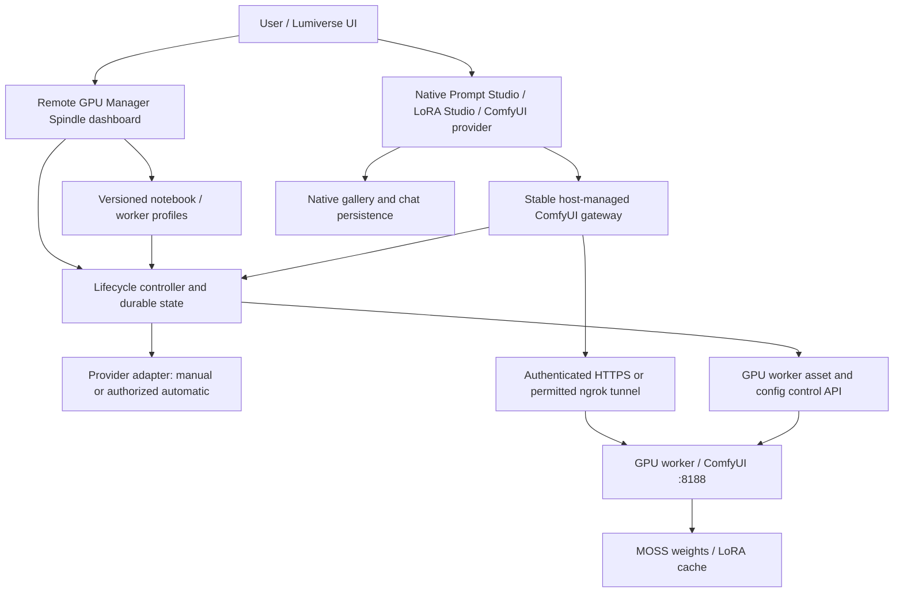

# Product Requirements Document
## Lumiverse Remote GPU Manager

**Version:** 1.1 · **Date:** 2026-11-17 · **Status:** M0 source discovery complete; M1 (warm connectivity) in progress — local gateway+mock verified (9/9 tests), live Lumiverse wiring pending owner's Space approval; provider feasibility gates: manual-only owner decision 2026-11-17 (see §15)  
**Target:** Lumiverse Spindle extension + minimal host-side gateway + remote GPU worker  
**Initial inference profile:** MOSS-Image SFT INT8 / ComfyUI (Anima family also in scope — see Decisions below)  
**Deployment:** Develop locally; deploy alongside the existing Lumiverse Hugging Face Space.

## 1. Executive summary

Build a lightweight, model-agnostic remote GPU manager that makes remote ComfyUI feel like a native Lumiverse image-generation provider. A user requests an illustration from Lumiverse; the manager checks the GPU, starts and bootstraps an authorized runtime when supported, restores required models and LoRAs, establishes an authenticated connection, and lets Lumiverse's native image generation pipeline submit the workflow. It monitors genuine work, keeps its own idle-shutdown timer from interrupting jobs, saves results through Lumiverse, and releases managed compute when idle.

The extension must own **runtime lifecycle management (start, shutdown, health and activity management)**, secure connectivity, remote notebook/worker configuration, and remote asset installation. Do not rebuild Lumiverse's Prompt Studio, LoRA Studio, Dream Weaver workflow editing, character bindings, output gallery, or scene-aware generation. A small host gateway or narrowly scoped native provider patch is acceptable where Spindle cannot intercept or relay native requests.

**Critical constraint:** The user currently uses Google Colab Free. Google documents remote proxy restrictions for managed runtimes and restrictions on primary external-web-UI interaction for free managed runtimes. A previously successful Ngrok inference test establishes technical connectivity only, not permission or future availability. Fully automatic Colab Free inference is an unresolved—and under current published rules, unsuitable—production deployment target. Ship manual/interactive Colab Free mode and a provider-agnostic lifecycle layer; enable unattended generation only on a host and account that explicitly allow it. Do not simulate notebook clicks, generate fake activity to defeat idle limits, or conceal traffic. Do not substitute Colab Enterprise for consumer Colab without explicit user opt-in and cost disclosure.

## 2. Context and baseline

### 2.1 Confirmed by the user

- Existing Lumiverse server is hosted separately on a Hugging Face Space; development will occur on a local checkout.
- MOSS-Image successfully generates images inside a Colab notebook. The Civitai LoRA downloader and LoRA application have been tested successfully by the user.
- An authenticated Ngrok tunnel returned HTTP 200 for the remote `/system_stats` endpoint and a generation submitted through the remote API returned an image. That test originated from Colab; independent connectivity from the actual Lumiverse Space has not yet been validated.
- A prior Anima notebook with the ArcAnima Ref Adapter worked; model switching to MOSS is intentional. Do not apply the Anima adapter to MOSS.
- A resource snapshot without extra LoRAs showed approximately 10.7/12.7 GB system RAM and 10.6/15 GB GPU VRAM. This is one session snapshot, not an inference peak or a guarantee for every runtime.
- User wants fully automatic runtime start/shutdown triggered by generation, configurable retention during genuine activity, and remote LoRA installation. The extension must also remotely configure most settings exposed by the working notebook, including settings needed before initialization; it must not require manual cell edits in normal supported operation. No new paid service is authorized.

### 2.2 Existing local artifact

`Unified_MOSS_Anima_Colab_Studio.ipynb` is the reference implementation; inspect the actual working notebook and its latest user-side edits before extracting code. It **supersedes** `wildthingsstudio101.ipynb` (kept in history) as of 2026-11-17: one ComfyUI checkout (`/content/Unified_ComfyUI`) serves **two model families** — MOSS (SFT/Base INT8, `Comfy-Org/MOSS-Image`) and Anima (Turbo/Aesthetic v1.0–v1.1, Base v1.0, `circlestone-labs/Anima`) — with family-specific LoRA directories (`models/loras/<family>`), per-family cache, managed model-switch semantics (idle check before `stop_owned_server()`), a dedicated Civitai installer with family-aware base matching and signature validation, an Anima-only Reference Adapter path (`ComfyUI-Anima-Ref-Adapter`, Base v1.0 target), and a corrected ngrok cell (default OFF, awaited forward, 12-attempt verified health check, auto-closes the tunnel if anonymous access returns HTTP 200). Preserve its interactive generation mode as a regression baseline.

| Component | Reference value |
|---|---|
| ComfyUI | Native MOSS+Anima-capable build; `git clone --depth 1` of master with optional `UPDATE_COMFYUI`; no commit pinning yet — **pin the tested commit after discovery** |
| MOSS (default family for this project) | SFT INT8 `moss_image_sft_int8_convrot.safetensors` / Base INT8 `moss_image_base_int8_convrot.safetensors`; encoder `qwen3.5_9b_w4a8_gptq.safetensors`; VAE `flux2-vae_small.safetensors`; repo `Comfy-Org/MOSS-Image`; clip_type `moss_image`; latent `EmptyFlux2LatentImage` |
| Anima (supported workbook family) | Checkpoints `anima-{turbo,aesthetic}-v{1.0,1.1}(b?).safetensors` + `anima-base-v1.0.safetensors`; encoder `qwen_3_06b_base.safetensors`; VAE `qwen_image_vae.safetensors`; repo `circlestone-labs/Anima`; clip_type `stable_diffusion`; latent `EmptyLatentImage`; defaults Turbo 10 steps/CFG 1.0, Base/Aesthetic 30/4.5 |
| Local endpoint | `http://127.0.0.1:8188` |
| Launch | `main.py --listen 127.0.0.1 --port 8188 --lowvram` (mode configurable `lowvram`/`normalvram`) |
| Defaults (as committed) | 768 × 768, `USE_MODEL_PRESET=True` (profile supplies steps/CFG), CFG 2.5/steps 25 for MOSS, `er_sde`, `simple`, batch 1, `SEED=-1` |
| Seed | -1 = randomize (normalize to native supported range) |
| Export | `/content/unified_workflow_api.json` and `/content/<family>_workflow_api.json` |
| Optional cache | `/content/unified_model_cache` (or Drive `MyDrive/Unified_Image_Assets` only when interactively mounted) |

Naming of record: family-specific LoRA names `civitai_<versionId>_<fileId>_<sanitized original name>` (unchanged); family-prefixed weights (e.g. `moss/…`, `anima/…`) appear in the exported API graph. Anima Reference Adapter must never be applied to MOSS; it is Anima-Base-v1.0-targeted and Experimental-gated elsewhere. Notebook defaults `INSTALL_ANIMA_ADAPTER = True` and `MODEL_CHOICE = 'Anima Turbo v1.1'` as committed — the user's Lumiverse target profile (MOSS vs Anima) is pending confirmation; see §15.

The notebook uses `LoraLoaderModelOnly` by default, and offers `LoraLoaderBypassModelOnly` only if available. Additional loaders and weight types must be tested with this quantized model before release.

### 2.3 Native Lumiverse features to reuse

| Native capability | Manager responsibility |
|---|---|
| ComfyUI connection profile and configurable URL | Stable gateway URL and secure upstream routing |
| Workflow import (editor/API JSON), field mappings | Provide tested MOSS template; verify auto-detection and manual overrides |
| Prompt Studio and scene parser | Preserve generated positive/negative prompts; no duplicate LLM calls |
| LoRA Studio, installed-file discovery, layers and weights | Install assets remotely, refresh native catalog, preserve exact identities |
| Character LoRA bindings, trigger tags | Restore referenced assets before generation; native binding remains authoritative |
| Native previews, progress, cancellation, gallery | Preserve HTTP/WebSocket semantics and existing job ownership |
| Extension image API | Optional test or fallback path only; feature-detect host support |

Actual installed Lumiverse version/commit: **upstream `main` v1.2.5 @ `45f8db56` was inspected for M0; the deployed Space build has not been confirmed — see `docs/m0-discovery-report.md` §1 and §15.** The prior source review indicated missing Basic Auth support in the ComfyUI provider; **confirmed on v1.2.5** (no `Authorization` header support anywhere in the ComfyUI provider/runner/discovery paths; only SwarmUI sends a `Cookie`) — treat this as confirmed source behavior, not a permanent assumption, and re-check on the deployed build. Verify that native LoRA Studio supports the MOSS-specific model-only loader and weight insertion, **not just SDXL-style `LoraLoader`** — M0 found auto-detection and the node patcher are `LoraLoader`-only; see §15 and ADR-001.

## 3. Product goals and scope

### P0 — required for the usable release

1. Stable native ComfyUI connectivity from the real Lumiverse deployment; ngrok Basic Auth forwarded server-side; no public unauthenticated worker.
2. Runtime state dashboard, explicit start/stop/restart, offline state with actionable remediation, and reconnection to a previously started authorized worker.
3. Lifecycle provider abstraction, single-flight provisioning, genuine job activity tracking, configurable idle shutdown, owned-runtime reconciliation, capability discovery for Google Colab.
4. Preserve native generation, output saving, prompt mappings, progress and cancellation. Show provisioning progress before generation, without blocking unrelated Lumiverse operations.
5. Remote Civitai LoRA installation with regular model-page URLs and exact version links; compatible-version resolution; authentication; persistent manifest; installed-file refresh.
6. MOSS baseline workflow and resource guardrails; no model-specific assumptions in the core manager.
7. Secure secret storage, explicit consent for provisioning/billing, safe failures and developer tests.
8. **Remote notebook settings management:** a durable, versioned runtime profile editor and authenticated configuration API covering bootstrap, model selection, cache, inference defaults, LoRA installation and tunnel settings. Support offline staging and explicit apply/restart semantics. Native generation controls remain authoritative for job-specific values; do not require manual notebook cell edits during supported operation.

### P1 — after real end-to-end generation

- Automatic start on a native generation request on supported hosts, automatic bootstrap and authenticated discovery, unattended deletion after idle. **Descoped by owner decision 2026-11-17: manual-only indefinitely; reported unfulfilled. Activation would require a new owner decision and a permitted host, and is not on the current plan.** If the target cannot support it, report the requirement unmet rather than claim completion.
- Google Colab API adapter where eligible and authorized for the intended workload; alternative supported on-demand GPU provider only after user approval. **Pending: read-only eligibility test approved (2026-11-17); policy blocks managed Colab for automation regardless (see ADR-002 and §15).**
- Optional restore of pinned LoRA sets on cold boot; first-run setup wizard; richer resource logs and configurable memory policy.

### Non-goals

No replacement image generator, duplicate LoRA weights/presets UI, custom sampler implementation, reference adapter port, generalized model training, paid provisioning without opt-in, or browser automation to bypass provider session limits. No automatic modification of unrelated connection profiles. Multi-user shared GPU fairness is outside first release; isolate one designated user's state and deny cross-user access.

## 4. User experience and functional requirements

| ID | Requirement | Acceptance criteria |
|---|---|---|
| R-01 | Connection setup | User selects one dedicated native ComfyUI profile; registers authorized worker URL and credentials privately; Test reports upstream JSON success from actual Lumiverse server; invalid auth shown clearly. |
| R-02 | Dashboard | Shows Offline/Starting/Bootstrapping/Connecting/Ready/Busy/Idle/Stopping/Error, GPU, RAM/VRAM, runtime age, queued jobs, last error, idle countdown, provider capability and authorization status. Start/Stop/Restart buttons work where supported; unsupported controls explain why. |
| R-03 | Start / warm reuse | On permitted automatic provider, first native generation request starts exactly one owned runtime and holds request until worker ready; further requests reuse it. On manual Free mode, show `Needs manual startup` and preserve user intent without auto-submitting remotely. |
| R-04 | Bootstrap | Reproducible pinned ComfyUI installation, model cache restore/download, node and model verification, health checks; no duplicate services. A worker is Ready only after model files, required nodes and routed authentication pass. |
| R-05 | Activity / keep-alive | Hold runtime against **manager's own shutdown** while real generation, queued jobs, result retrieval or authorized asset installation is active. Respect provider idle and lifetime limits. No heartbeat traffic whose purpose is to defeat provider idle enforcement. |
| R-06 | Idle shutdown | Default proposed 10 min after last real work; configurable 5/10/15/30 min or disabled where permitted. Under lock, recheck native queue, leases and output retrieval; release owned runtime via supported API. Status confirms deletion, not merely stopping ComfyUI. |
| R-07 | Manual stop/restart | Normal Stop drains jobs; Force Stop requires explicit confirmation, marks affected jobs cancelled/unknown as applicable, never deletes another session. Restart clears stale routing and revalidates fresh endpoint. |
| R-08 | Native generation | Native scene illustration uses MOSS graph; prompt, dimensions, seed, sampler, CFG, steps map correctly; gallery/chat attachment, progress and cancellation work normally; repeated requests do not rebuild runtime. |
| R-09 | Remote LoRA installer | Accept `civitai.com` / `civitai.red` model pages, exact version URL, direct Civitai download URL, or local upload fallback. Present compatible versions before transfer, exact ID/filename, size, base, trigger tags and errors. Install remotely, refresh or instruct user to refresh native model catalog. |
| R-10 | Recovery | Survive extension/Lumiverse restart, ngrok brief propagation lag, stale endpoint and expired GPU; reconcile durable owned runtime and known prompt IDs. Never blindly resubmit an uncertain POST `/prompt`. |
| R-11 | Memory and limits | Show available memory; single concurrent inference initially; batch 1 (MOSS default). Guard downloads and generation at configured resource thresholds; no automatic swapping to a paid GPU or killing active inference. |
| R-12 | Secrets and privacy | No token in URLs, prompts, logs, workflow JSON, frontend state after submit or exported settings; TLS upstream; unauthorized requests denied; redact prompt and output content from operational logs. |
| R-13 | Remote notebook configuration | Edit most settings in the working notebook through Lumiverse; settings persist offline, are sent to the authorized worker at startup or applied remotely when safe, and show desired/effective values and apply status. See §7.5 for field coverage. |
| R-14 | Settings apply and restart | Changes classify as next-job, hot/idle apply, worker restart, or runtime reprovision. Preview disruption and asset needs; never restart during an active job. Reconcile revisions, reject stale writes and expose failure without silently claiming settings applied. |
| R-15 | Standalone notebook compatibility | Notebook forms and remote worker bootstrap consume a common validated config schema. Interactive notebook still runs without Lumiverse; native Lumiverse request settings take precedence over remote defaults for that request. No arbitrary remote cell execution or notebook UI scraping. |

## 5. Architecture

### 5.1 Deployment topology



Keep control plane on the Lumiverse server (not a browser tab and not the ephemeral GPU). Keep inference and model files on the GPU. Store state on the Space's persistent volume, not its ephemeral container filesystem; verify current mount (historically `/app/data`) and access rights. Local dev should work against a fake worker or existing local ComfyUI without cloud credentials. Avoid exposing a new public gateway port on the Space.

### 5.2 Native integration decision (mandatory discovery spike)

A Spindle extension alone cannot be assumed to register a raw HTTP/WebSocket listener, mutate native image connection profiles, or intercept every native image-generation request — **M0 confirmed all three are impossible with the current SDK (`lumiverse-spindle-types` 0.6.49 host pin / 0.6.80 latest): no inbound listener API exists (raw socket/HTTP-server modules are hard-blocked with no opt-in capability), connection profiles are read-only from Spindle (`listConnections`/`getConnection`/`getModels`), and there is no pre-image-generation hook.** Current Spindle backend documentation hard-blocks raw socket/HTTP-server modules and direct filesystem/process APIs. Use documented scoped surfaces only; never work around static scanning. See `docs/adr-001-native-integration.md` for the M0-verified analysis.

Preferred order:

1. Test latest installed native ComfyUI auth behavior (HTTP and WS), profile management API and any documented pre-image-generation hook; confirm cold-start request timeout behavior. If supported, integrate through native APIs.
2. If absent, introduce a **minimal host-side gateway** as a separate trusted process/service or a first-party route in the local Lumiverse fork. A stable, access-controlled base URL is configured once on the native profile. The gateway adds auth upstream and invokes the lifecycle controller before a generation request; it must support WebSocket upgrade, streaming and binary output. Ensure internal routing works from the Lumiverse process and authorized UI routes, without exposing the unauthenticated connector to the public internet.
3. If native provider's initial health/catalog requests or WebSocket connects before submission prevent cold-start, add the narrowest host-side preflight patch in the ComfyUI generation entrypoint: `ensureReady(profileId, jobId)` before opening the generation HTTP/WS session. Keep discovery requests non-provisioning. Feature-detect optional `spindle.imageGen.generateNative()` for extension-triggered smoke tests, not as a universal native hook.
4. If a pure extension cannot perform this control, deliver the extension plus separately installable host integration rather than silently replacing native generation or claiming a pure-Spindle solution. Document upstream patch, update conflicts, and rollback.

### 5.3 Integration contracts

The following TypeScript names are **proposed internal interfaces**; they are not claims about existing Spindle methods. Implement against the installed SDK and its actual signatures.

```ts
type RuntimeState = 'offline' | 'needs_manual_start' | 'starting' |
  'bootstrapping' | 'connecting' | 'ready' | 'busy' | 'idle' |
  'stopping' | 'error' | 'unknown';

type Capabilities = {
  autoProvision: boolean; autoDelete: boolean; externalInferenceAllowed: boolean;
  supportsRuntimeDiscovery: boolean; persistentStorage: boolean;
};
interface RuntimeRef { provider: string; id: string; owned: boolean; epoch: number; }
interface WorkerEndpoint { baseUrl: string; secretRef: string; epoch: number; }
interface GpuProvider {
  capabilities(): Promise<Capabilities>;
  listOwned(): Promise<RuntimeRef[]>;
  provision(requestId: string): Promise<RuntimeRef>;
  bootstrap(ref: RuntimeRef, profileId: string, configRevision: number): Promise<WorkerEndpoint>;
  inspect(ref: RuntimeRef): Promise<RuntimeState>;
  release(ref: RuntimeRef): Promise<void>;
}
// Controller: ensureReady(job), acquireLease(job), releaseLease(job),
// reconcile(), scheduleIdle(), start(), stop({force}), restart(), status().
```

Provider methods may fail with typed `UNSUPPORTED`, `AUTH_REQUIRED`, `QUOTA_EXCEEDED`, `POLICY_RESTRICTED`, `TIMEOUT`, `OFFLINE`, or `AMBIGUOUS`. Disable unsupported actions before making network calls. Treat lack of proof of external-inference authorization as false. A manual registered endpoint is not an owned runtime; clearing the registration is not equivalent to releasing compute.

### 5.4 ComfyUI gateway contract

Support upstream requests required by the native provider, determined from source and traces. Baseline routes from the proven notebook: `GET /system_stats`, `GET /object_info` (including node-specific variant), `POST /prompt`, `GET /history/{prompt_id}`, `GET /view`, `GET /queue`, `WS /ws`; forward authenticated `POST /upload/image`, cancellation routes and catalog routes when actually used. `/free` is privileged and must be gated on idle. Keep route allowlist versioned, no arbitrary upstream URL proxy, no credential-bearing redirects to arbitrary hosts. ComfyUI base path `/api` aliases vary by version; verify exact native paths.

Read-only discovery, health and preview requests never allocate a GPU by themselves. Use a tied job context for startup; do not lose the native WS client ID. Preserve response status, content type and image bytes. Gateway timeout policy must distinguish startup from generation and image download; never hold an unbounded HTTP request. If proxy WS transport cannot be supported on the deployment, use native-compatible polling only after verifying progress/cancel behavior.

Ngrok Basic Auth: add server-side `Authorization: Basic …` and, if needed, `ngrok-skip-browser-warning: 1`; use upstream TLS validation; test authenticated WS handshake separately. Prefer one user-owned stable domain when supported or register endpoint per boot with runtime epoch and one-time registration credential. Never embed credentials in profile URL or frontend JS. Ngrok authtoken differs from tunnel Basic Auth credentials. On the permitted worker, await `ngrok.forward()` in an active event loop before reading `.url()`; await async close when required. Retry transient 404/502 on startup with bounded backoff and validate JSON, expected node/model fingerprint, and worker identity rather than treating an HTML 200 as Ready.

## 6. Runtime lifecycle details

### 6.1 Google Colab feasibility gate

Start here before writing full automation. Google's public v1beta Colab API exposes runtime specifications, create/get/list/delete operations, and runtime connection details; its MCP interface also describes session creation and code execution. API existence does not guarantee GPU eligibility, Cloud project enablement, paid/free availability, notebook association, Drive mounting support, or permission to operate an external inference service.

- Read Google API documentation and terms; test with the user's explicit OAuth authorization, `https://www.googleapis.com/auth/colaboratory.readonly` (eligibility only — no allocation) then `https://www.googleapis.com/auth/colaboratory` if a provisioning decision is approved, and an enabled eligible Cloud project (no billing change without consent). Store refresh credentials only server-side. Confirm exact OAuth flow, quota and subscription tier; list eligible GPU specs and record results without allocating compute unnecessarily. **M0 finding (2026-11-17): managed Colab prohibits, for ALL tiers, connecting to remote proxies and web-service offerings unrelated to interactive compute; Free additionally prohibits remote control and web-UI-primary interaction. Treat every managed tier as unsuitable for unattended Lumiverse-driven inference. See `docs/adr-002-provider-feasibility.md` — manual Free mode is the supported path; unattended mode requires an explicitly approved non-managed host (own GPU / dedicated VM / Colab Enterprise under user billing).**
- For a permitted workload, prove create → operation completion → runtime lookup → Jupyter session / authenticated code execution → delete of **only the created runtime**. Use documented connection info and short-lived `X-Colab-Runtime-Proxy-Token` when applicable. Do not infer MCP transport availability from REST endpoints; verify actual supported client and API contract.
- Separately verify whether intended API inference and external connectivity are permitted for the chosen host. For current managed Colab Free, external tunnel usage is not the supported production plan. Do not assume paid consumer Colab automatically removes all proxy restrictions either. A successful API lifecycle smoke test does not remove the policy gate.
- Manual Free adapter: interactive notebook generation, manual connection/delete through Colab, status/diagnostics only where legitimately accessible. Extension can show launch notebook instructions and distinguish `needs_manual_start` from `offline`. No remote worker automation on a prohibited configuration. Retain existing experimental results as technical evidence; do not use them as authorization.
- If eligibility or policy fails, stop automatic deployment and report the gap. With explicit user approval, select an API-controlled GPU host designed for remote inference and apply the same provider contract; no cost estimate or subscription commitment is assumed here.

### 6.2 State machine and concurrency

```text
OFFLINE -> STARTING -> BOOTSTRAPPING -> CONNECTING -> READY
READY -> BUSY -> IDLE -> STOPPING -> OFFLINE
IDLE + new job -> BUSY
OFFLINE + unsupported automatic provider -> NEEDS_MANUAL_START
Any transitional state + confirmed failure -> ERROR
Lost connectivity with unknown provider state -> UNKNOWN -> RECONCILE
```

Single-flight `ensureReady` per provider/account/profile pool, backed by durable ownership and an atomic interprocess lock when more than one controller exists. One generation worker at a time initially; queue native jobs rather than launch duplicate machines. New work cancels pending idle-stop under the same lock; if deletion has already begun, wait for definitive stop and then provision a fresh runtime only if authorized. Runtime epoch fences stale workers, prompt IDs and endpoint registrations. Record allocation intent before calling create, then record the provider runtime ID/operation ID immediately. On ambiguous create, query/reconcile before retry. Do not adopt or delete unrelated assignments.

Track leases for active native job, queued job, image retrieval/persistence, and asset restore/install. Inspect ComfyUI queue for separately submitted work. Compute real activity from accepted work, not health polling or websocket messages alone. Keep-alive means suppress the controller's own idle shutdown while a real job is underway; no fake execution, simulated clicks or periodic workload to defeat Colab's limits.

Suggested configurable defaults (not measured): health check every 15–30 s only while a legitimately active managed service needs monitoring; idle 10 min; provisioning 15 min, bootstrap up to 30 min with visible progress, sampling 30 min initially, request retry 3 with bounded exponential backoff. Increase before cold-start if observed necessary. Set provider-side maximum lifetime/budget and watchdog if supported. On expiry show clear errors, do not loop provisioning indefinitely. Stop only after drain and verified release. If process crashes, on restart reconcile by owned runtime ID and absolute expiry, not a lost in-memory timer. If server is suspended, provider limits are the fallback; cannot guarantee shutdown from a sleeping Space.

## 7. Worker and model/LoRA management

### 7.1 Worker bootstrap

Extract reusable idempotent Python from the actual notebook; keep a thin interactive notebook frontend and a noninteractive bootstrap for authorized remote hosts. Pin ComfyUI commit, Python/dependency versions, model repositories/revisions and hashes after successful local verification. Never run unreviewed shell scripts or optional custom nodes from arbitrary user URLs. Separate dependency installation, cache restoration, start, readiness, asset operations and shutdown. Keep process IDs and logs with redaction; do not force reinstall on a live healthy worker. Use configured model family/profile registry rather than scattering MOSS filenames in controller code.

Readiness: local `/system_stats` returns JSON; `/object_info` includes UNETLoader, CLIPLoader with `moss_image`, VAELoader, CLIPTextEncode, EmptyFlux2LatentImage, KSampler, VAEDecode, SaveImage and tested model-only LoRA loader; exact checkpoint/encoder/VAE names present. Authenticated gateway probe succeeds. Optional small smoke image in setup/testing only, not at every health check. Record worker version and installed manifest.

### 7.2 MOSS workflow contract

Generate an API template from the notebook with no baked-in LoRAs as the default. Native LoRA Studio inserts the stack once; never insert both static and dynamic LoRA nodes inadvertently. Graph IDs in the inspected notebook: `1 UNETLoader`, `2 CLIPLoader (type=moss_image)`, `3 VAELoader`, `4/5 CLIPTextEncode positive/negative`, `6 EmptyFlux2LatentImage`, `7 KSampler`, `8 VAEDecode`, `9 SaveImage`; optional model-only LoRAs use IDs starting at `100` before KSampler. Map checkpoint (`1:unet_name`), encoder (`2:clip_name`), VAE (`3:vae_name`), prompt text fields (`4:text`, `5:text`), dimensions (`6:width`, `6:height`), seed/steps/CFG/sampler/scheduler (`7:*`). Validate native mapping handles the separate encoder and `EmptyFlux2LatentImage`. Native resolution and workflow mapping are authoritative. Test native model-only LoRA stacking; if not supported, request small host patch to insert `LoraLoaderModelOnly` and avoid duplicate CLIP weight logic. Keep generated filename prefix safe; use native result persistence.

### 7.3 Remote asset control API (proposal)

Implement a separate narrow authenticated worker service or approved reviewed ComfyUI custom route. Ordinary ComfyUI `/upload/image` is not a model downloader. Worker management may run on an internal port, through explicitly scoped authenticated routing on approved hosts. Do not expose arbitrary code execution or arbitrary filesystem access. Suggested resources:

| Method/path | Behavior |
|---|---|
| GET `/manager/v1/status` | worker ID/epoch, versions, resource metrics, queue and assets summary |
| GET `/manager/v1/loras` | installed model-only LoRA catalog, stable filename, verified compatibility/provenance |
| POST `/manager/v1/loras/resolve` | Civitai URL -> compatible version/file candidates, no transfer |
| POST `/manager/v1/loras/install` | authenticated, idempotent install of exact version/file; returns operation ID |
| GET `/manager/v1/operations/{id}` | transfer progress bytes, status, safe error, resulting filename |
| POST `/manager/v1/loras/upload` | optional bounded streaming manual `.safetensors` upload |
| DELETE `/manager/v1/loras/{assetId}` | optional explicit confirmation; refuse when in use; no arbitrary paths |

Downloader: normalize `.com` and `.red`; use Civitai model metadata `/api/v1/models/{id}` and exact version `/api/v1/model-versions/{id}`. With general model URL choose MOSS-compatible version (show selection; if multiple compatible choices, show list and let user choose or explicitly confirm default). For exact version, reject incompatible model family, even if another compatible version exists. Check type LoRA, base-model metadata normalized to MOSS/MOSS-Image, file selection `.safetensors`; preserve file ID from direct links. Unknown metadata fails safely, with manual upload labeled unverified. Resolve current authorized download URL; do not bypass account restrictions. Optional Civitai token sent only to trusted Civitai destinations; strip on untrusted redirects. 401/403 -> retry with authorized token or manual browser download/upload; no cookie scraping or credential dumping.

Stream to `.part`, check capacity first, cap transfer size, validate safetensors structure with a trusted parser, verify SHA-256 when published, atomic rename, stable name `civitai_<versionId>_<fileId>_<sanitized original name>`. Cache manifest includes source model ID/version/file IDs, original label, installed filename, hash, expected family, size, trigger words, last verified and storage location. No raw tokens or signed URLs persisted. Reuse verified cached files, clean incomplete transfers, prevent symlink/path traversal, avoid duplicate concurrent downloads. Downloaded weights are not trusted code; reject unsafe formats. Native catalog refresh after install; preserve exact names on restart so existing native character/style bindings keep working.

Do not implement a second LoRA weight/preset editor; native LoRA Studio is authoritative. Manager may show installed assets, metadata and required missing assets. If native stack cannot be read ahead of request, inspect final graph's allowlisted LoRA node inputs in gateway and restore manifest-matched files before submission (or fail with explicit missing names). Do not automatically infer arbitrary source URLs from filenames. Validate only compatible registered assets and report incompatible or unknown weights.

### 7.4 Resource management

Persist manifest and assets outside ephemeral runtime using approved storage. Notebook's optional Drive cache is interactive; do not assume API-provisioned sessions support unattended Drive mounting. Approved host may use persistent volume/object store. Disk estimates roughly 13–15 GB or more for one model set; avoid duplicate download caches and both checkpoints by default. Measure free disk before staging, count cached assets and temp writes.

Initial defaults: T4-oriented quantized weights, lowvram, batch 1, 768². Warn at roughly 85% RAM or under 2 GiB available; thresholds configurable and advisory, not an exact OOM predictor. Capture resource values before/after cold load and inference, including peak if available. Optional `/free` unload only while idle/no queue, before changed LoRA sets if tested beneficial; offloading may increase system RAM. Avoid auto-changing memory flags or reducing quality without user consent. OOM -> explicit actionable error and retry after user chooses lower resolution/fewer LoRAs or supported configuration. Do not silently retry with changed seed/settings. Scope metrics to worker; no unnecessary `torch` GPU context in notebook diagnostics.

### 7.5 Remote notebook configuration (P0)

The extension is the remote control panel for the notebook and its extracted worker. Do not implement this by programmatically editing live Colab widgets or submitting arbitrary cells. The notebook’s `@param` forms are a local front end; assigning Python variables after a cell runs is not equivalent to reconfiguring a running worker. Refactor bootstrap and generation helpers to accept a typed, serializable profile. A local notebook adapter translates its form values into the same schema, and an authorized remote bootstrap consumes the profile through a documented provider mechanism. On a running authorized worker, use a narrowly scoped authenticated configuration API, not a general-purpose Python execution endpoint.

**Coverage inventory** — based on the inspected `MOSS_Image_Colab_Studio.ipynb` (Sections 1–13) and the user's later-described workflow-download/Ngrok fixes. Some controls below expose previously hardcoded notebook choices; these are proposed enhancements, not claims that the original notebook had widgets for them.

| Notebook section / setting | Lumiverse control and effective behavior | Apply class |
|---|---|---|
| 1 · GPU check | Eligible GPU/runtime specification selector, device and capacity display; capability gated | Reprovision |
| 2 · `USE_DRIVE`, `CACHE` | Persistence toggle and approved storage preset/root; report mounting status and capacity. Interactive Drive authorization stays local if no supported remote auth exists | Bootstrap / restart or reprovision |
| 3 · ComfyUI install/update | Pinned approved ComfyUI revision, dependency/profile selection, update action with explicit confirmation; no arbitrary repo URLs or command flags | Worker restart / bootstrap |
| 4 · `MODEL_CHOICE` | MOSS SFT INT8 / Base INT8 profile selection; fetch and validate required assets before activation | Stage + idle apply |
| 4 · `ENCODER`, `VAE` | Compatible, registered encoder/VAE selectors; pinned revisions, filename validation, availability and disk cost. Never permit arbitrary filesystem paths | Stage + idle apply |
| 5 · Restore saved LoRAs | Restore mode (required/pinned assets or selected cached library), retention, status and retry/restore action | Bootstrap / idle apply |
| 6 · ComfyUI launch | Memory mode (supported low/normal VRAM modes), allowlisted offload/cache policy, log level; internal bind stays loopback, port fixed or approved host mapping | Worker restart |
| 7 · API helpers | Managed endpoint read-only, request/queue timeouts, exportable clean workflow template and version; actual route transport is gateway-owned | Config / next job |
| 8 · `UPLOAD_LOCAL_LORA` | Authenticated manual upload action on supported worker; no browser-file-picker automation | Asset operation |
| 9 · Civitai LoRA UI | Remote install/remove/restore, Civitai secret reference, catalog refresh. Selection, enablement and individual strengths use native LoRA Studio, not a second stack | Asset operation / next job |
| 10 · `POSITIVE_PROMPT`, `NEGATIVE_PROMPT` | Native prompt fields and scene parser; optional standalone defaults only, no private chat duplication | Next job |
| 10 · `WIDTH`, `HEIGHT`, `STEPS`, `CFG`, `SEED`, `SAMPLER`, `SCHEDULER` | Native generation controls / workflow mappings; profile holds default values where needed, with per-job overrides | Next job |
| 10 · `CLIP_DEVICE`, `LORA_LOADER` | Advanced compatibility fields, validated against `/object_info`; model-only loader choices for MOSS; native workflow mapping must use selected compatible loader exactly once | Next job / idle apply if storage or model reload required |
| 11 · Generate and export | Native generation action and gallery; optional download clean API workflow, save outputs to approved storage, filename policy; no forced browser download | Next job / explicit action |
| 12 · `ENABLE_NGROK` | Tunnel mode/off, approved domain or dynamic endpoint, secret refs for authtoken and Basic Auth, connect/disconnect/rotate; endpoint is read-only status | Idle reconnect / bootstrap |
| 13 · Diagnostics/shutdown | Memory status, bounded redacted logs, model/LoRA inventory, memory release while idle, stop worker vs release runtime as distinct actions | Explicit action |
| Extension lifecycle settings | Automatic start, idle duration, activity leases, max runtime, retries, monitoring interval, queue limit, provider budget (if approved) | Controller hot apply / reprovision if provider requires |

Apply classes: **next job** leaves submitted graph immutable; **idle apply** stages and validates without interrupting work; **worker restart** drains the queue, applies changes and rechecks readiness while retaining runtime if possible; **reprovision** explicitly releases/recreates only an owned runtime when permitted. Asset tasks carry activity leases. No silent changes to image quality, provider tier, storage destination, security policy or native workflow. If a model switch would invalidate existing LoRA bindings, surface incompatibilities before accepting affected jobs. Do not assume all worker modes or encoder variants exist; show only verified choices from schema and provider capability discovery.

#### 7.5.1 Profile and API contract

Store profile independently of a running runtime. Proposed logical structure (not a pre-existing Spindle API):

```ts
type ApplyMode = 'next_job' | 'hot' | 'idle' | 'restart_worker' | 'reprovision';
interface NotebookProfile {
  schemaVersion: number;
  id: string;
  revision: number;
  provider: { driverId: string; runtimeSpecId?: string };
  bootstrap: { comfyRevision: string; modelProfileId: string; encoderId: string; vaeId: string };
  storage: { presetId: string; persistAssets: boolean; restorePolicy: string; persistOutputs: boolean };
  worker: { memoryMode: string; cachePolicy: string; logLevel: string; maxConcurrency: number };
  generationDefaults: { width: number; height: number; steps: number; cfg: number; seed: number;
    sampler: string; scheduler: string; clipDevice: string; loraLoader: string };
  tunnel: { enabled: boolean; endpointMode: string; approvedDomain?: string; credentialRef?: string };
  assets: { pinnedAssetIds: string[]; civitaiCredentialRef?: string };
  lifecycle: { autoStart: boolean; idleMinutes: number | null; maxRuntimeMinutes?: number; jobTimeoutSeconds: number };
}
```

Positive/negative prompt text and LoRA strengths are sourced from native job data; standalone demo prompts remain local or in explicit presets, never silently captured from chat. Secrets use a write-only secret interface and opaque IDs; profile exports exclude secrets. The schema is versioned and migratable; server-side validation is authoritative. Use typed enums/ranges and discovered compatibility; reject unknown fields and reject unsupported options before mutating state. Keep defaults equivalent to the proven notebook until tested. Provider-specific options are typed extensions, not arbitrary dictionaries of shell commands. Restrict file paths to approved storage roots.

Proposed authenticated worker routes extend §7.3 (controller-facing, not exposed as arbitrary browser endpoints):

| Method/path | Behavior |
|---|---|
| GET `/manager/v1/config/schema` | Supported fields, choices, bounds, apply class, secret flags and unsupported reasons |
| GET `/manager/v1/config` | Effective nonsecret config, runtime epoch, revision and capabilities |
| POST `/manager/v1/config/plan` | Validate desired patch and revision, return asset needs, required apply classes, disruption and unsupported fields without mutation |
| PUT `/manager/v1/config` | Apply validated full desired revision with idempotency key, expected revision and epoch; return operation ID or typed conflict |
| GET `/manager/v1/operations/{id}` | Stage/apply/restart progress, applied revision, sanitized errors and remediation |

Offline: edit/save profile in Lumiverse, mark Pending, and deliver exact snapshot on the next authorized bootstrap. A disconnected worker must not be reported as updated. At runtime, compare desired and effective revisions; serialize applies with job and asset leases; reject conflicting or stale requests (optimistic concurrency); verify worker epoch and identity on callbacks. Plan before apply; obtain confirmation for disruptive changes; update effective revision only after read-back and required checks. Keep last-known-good configuration and offer explicit rollback; if previous settings cannot be restored safely, mark degraded and stop accepting affected jobs. Don't assume transactional rollback for provider deletion or failed mounts. Worker-only state (local UI changes) is reported as drift; ask operator to adopt or reapply, never overwrite silently.

#### 7.5.2 User interface and delivery

Add a **Notebook / Runtime Settings** page within Remote GPU Manager, with sections Model & encoder, GPU & memory, Storage & assets, Connectivity, Lifecycle, Advanced/defaults. Show active profile, desired/effective config revisions, pending change indicators, apply/restart impact, validation messages and a reset-to-tested-defaults action. Include Save for next startup, Apply now (when permitted and safe), Apply after current jobs, and Restore previous profile. Expose native generation settings through links or existing host UI, not duplicated sliders wherever native controls already exist. Show status and actions for unavailable capabilities, including authorization-required Drive mounting, runtime provisioning and remote application on restricted hosts.

Implementation: split existing notebook into shared `worker/config.py`, bootstrap, asset service and workflow builder; provide a versioned JSON sample and a thin notebook form adapter. Bootstrap must read the desired profile **before** downloading model files or starting ComfyUI. Pass secrets separately via the approved secret injection mechanism. Establish authenticated registration after initialization; control API changes should not depend on the browser tab remaining open. On a supported worker, a deliberate tunnel reconnect must be recoverable via the approved control path or bootstrap, and must not expose an unauthenticated endpoint. Standalone Colab interactive mode remains valid when remote control is unavailable. Remote live configuration and unattended delivery on Colab Free are feasibility/policy gated just like lifecycle and inference; prove these capabilities independently, and do not claim the extension can directly mutate the Colab UI or bypass provider restrictions.

## 8. Data, security and observability

Use `spindle.enclave` for extension-owned OAuth/Civitai/ngrok credentials (or host-managed vault for native gateway); use documented `spindle.storage`/user storage for preferences. Do not read/write host DB from Spindle or use raw forbidden imports. Secrets shared between trusted gateway and controller by approved host secret interface; no plaintext across frontend events. Use only needed permissions (`cors_proxy` for scoped HTTP, `image_gen` if extension actually generates, `images` only if fallback asset access required). Verify exact scope and installation policy for current SDK. Operator access must be explicit and isolated.

Durable records: `ProviderConfig` (capability flags, approved host, secret refs); `RuntimeRecord` (provider ID, owned flag, epoch, start/last activity/deadline, operation ID, status, endpoint fingerprint); `JobLease` (request ID, native prompt ID, runtime epoch, phases, timestamps, outcome); `AssetRecord` (manifest data); `NotebookProfile` (versioned desired settings and secret refs), `ConfigApplyRecord` (desired/effective revisions, epoch, operation, status and last-known-good revision); `AuditEvent` (timestamp, event type, correlation ID, redacted error class). Source of truth for prompts, weights and images is Lumiverse's native data. No duplicate private chat storage.

Gateway security: trusted upstream allowlist, validate scheme/host, block SSRF and private/link-local addresses except explicit trusted internal destinations, reject open redirects, authenticate control endpoints, separate operator and user actions, constant-time secret checks where relevant, rate/size limits, no arbitrary proxy destination or worker command execution. Do not publish raw ComfyUI unauthenticated. Worker callback registration requires nonce/expiry and owned runtime match. Redact user prompts, tokens, signed URLs and image data; metrics include provision/boot latency, job queue duration, inference latency, download/cache hit, disconnects, failed cleanup and estimated runtime duration. Provide logs with correlation IDs and safe copy diagnostics.

## 9. Suggested repository structure

```text
remote-gpu-manager/
  PRD.md
  spindle.json
  package.json
  src/
    backend.ts                 # documented Spindle lifecycle and RPC
    frontend.ts                # dashboard and installer UI
    controller/                # state machine, leases, reconciliation
    providers/                 # manual, Colab capability spike, future drivers
    integrations/              # native bridge client and catalog refresh
    assets/                    # metadata/manifest logic
    settings/                  # profiles, config planning/apply, drift reconciliation
    schemas/                   # DTO and versioned notebook-config validation
  host-gateway/                # separately trusted code; only if needed
  worker/                      # Python bootstrap, narrow asset/config service, notebook adapter
  profiles/moss-default.json   # nonsecret, tested default settings
  workflows/moss-api.json      # verified clean baseline from working notebook
  patches/                     # minimal upstream integration, if required
  tests/                       # unit, mock HTTP/WS, integration, failure fixtures
  docs/                        # deployment, security, recovery, policy matrix
```

Use TypeScript + Bun for host/extension in line with Lumiverse and Python for GPU worker. Use actual installed `lumiverse-spindle-types` with feature detection; current docs mention 0.6.38 for optional native controls. Pin compatible version and manifest `minimum_lumiverse_version` after local verification. Build with documented Spindle lifecycle, scoped backend/frontend messaging; host gateway is separately deployed rather than bundled around Spindle restrictions. Local repo and existing Space remain user-owned; don't overwrite live deployment automatically.

## 10. Development plan and gates

| Milestone | Deliverables / exit condition |
|---|---|
| M0 — discovery (first) | Record installed Lumiverse version/commit and GPU notebook versions; inspect actual provider auth HTTP/WS, native LoRA insertion and image request ordering; verify Colab eligibility and permitted operations separately. Inventory notebook settings and classify apply modes; verify remote config delivery before bootstrap and while running. Produce ADRs for gateway and provider feasibility. No production changes. |
| M1 — warm connectivity | Start a permitted already-running ComfyUI or mock; create stable gateway/native connection, authenticated health/catalog/WS, native workflow import, image generated from actual Lumiverse server and saved natively. Preserve current connections. |
| M2 — extension shell | Dashboard, persistent state, manual attach, typed errors, metrics, permission checks; versioned notebook profile editor, mock plan/apply API, offline staging, revision read-back; test server restart and endpoint rotation. |
| M3 — remote assets | Civitai resolver, confirmed compatible version, streaming installation, persistent manifest, native refresh and 0/1/two-LoRA tests with fixed seed. Test auth failure and manual upload. |
| M4 — lifecycle core | Mock provider with deterministic clock; start single-flight, bootstrap with staged config, drain, idle timer, cancellation, settings apply/restart, drift reconciliation and max lifetime. Prove on authorized automatic host only after opt-in. Manual Colab Free remains manual. |
| M5 — native cold start | Actual native image request triggers authorized GPU start, receives ready/progress, submits once, saves output, waits idle and confirms release. Validate second request reuses runtime, simultaneous requests allocate once and restart recovers. Demonstrate a remote profile change flowing to actual worker and one offline change consumed by next authorized bootstrap. |
| M6 — release | Local and Space deployment guide, pinned dependencies, security review, cleanup runbook, acceptance report and explicit remaining capability matrix. |

M0 must not block M1–M4 against mocks or permitted warm hosts. Do not label M5 complete with a mock, notebook-local test or manually started runtime. If no authorized automation backend is available, deliver partial release and mark lifecycle automation unfulfilled on the target account.

## 11. Acceptance test matrix

| Test | Expected |
|---|---|
| Warm native generation from real Space | Gallery output, native prompt/seed settings preserved, WS or supported polling progress; no credentials in browser/logs. |
| Auth wrong / unauthenticated | 401/403, no work accepted; no automatic downgrade to public endpoint. |
| Endpoint initially 404 then ready | Bounded readiness retry (observed ngrok behavior); no premature failure or duplicate tunnel. |
| Native request while offline, authorized provider | One allocation; pending job preserved; only submit after readiness. |
| Free Colab capability or policy denied | Explicit manual-only mode, no unattended allocation/tunnel or fake keep-alive. |
| Two simultaneous cold requests | One runtime, queue ordered, separate prompt IDs. |
| Discovery requests while offline | No runtime allocation. |
| Long real generation beyond idle threshold | Manager does not terminate in-flight job; provider limits remain respected. |
| New request during idle shutdown | Timer cancelled or safely reprovision after definitive release; no duplicate runtime. |
| User stops while busy | Drain or confirmed force stop; no unrelated runtime deletion. |
| Transport timeout after POST /prompt | Reconcile prompt state; no blind duplicate POST. |
| Space restart with active runtime | Owned record recovered; queue/leases reconciled; stale endpoint rejected; cleanup confirmed. |
| Civitai regular multi-version URL | Correct family candidate shown; exact incompatible version rejected. |
| 401/403 / truncated or hash mismatch model | Safe failure, no partial final file, native catalog remains unchanged. |
| Cached asset on new runtime | Same verified filename restored; existing native character binding works. |
| Native LoRA stack: off/0.6/1.0/two | Expected graph and weights, no duplicate insertion; inspect load logs and compare fixed-seed outputs. |
| OOM / disk full | Clear error; no unsafe retry or unapproved paid GPU use. |
| Worker outage / max runtime | Stop or reconcile only owned runtime; failure visible; provider budget/lifetime guard verified when available. |
| Remote profile saved while offline | All valid fields persist; next authorized bootstrap consumes exact revision before downloads and launch; no runtime starts just because settings saved. |
| Change model/encoder/VAE remotely | Compatible assets staged and verified; effective profile changes after drain/readiness; incompatible bound LoRAs flagged. |
| Change native generation settings | New request graph reflects overrides without mutating active job or duplicating LoRA insertion; standalone notebook defaults work independently. |
| Change memory mode during generation | Proposed restart is deferred until all jobs/asset leases drain; apply status visible; runtime not unnecessarily reprovisioned. |
| Unauthorized/unsupported config or stale revision | Reject without effect; no arbitrary code/paths, no secret leakage, conflicts and disabled controls explained. |
| Configuration apply fails / worker disconnects | Desired remains pending/failed; effective not falsely advanced; rollback or safe degraded state; reconcile after reconnect. |
| Tunnel settings changed | Controlled reconnect, authenticated health and epoch read-back; no credential exposure or public fallback. |
| Interactive notebook without manager | Local forms, LoRA uploads and inline generation still work using same schema. |
| Security | Reject path traversal, malicious filename, token-bearing redirects, unauthorized API calls, SSRF, oversized file; no secrets in export. |

Release criteria: all applicable P0 tests pass on the installed Lumiverse build; automatic deployment requires M5 on an explicitly permitted backend, plus verified deletion. Document which tests were live, mocked, skipped or blocked. Runtime startup and speed targets must be based on measured cold/warm results, not assumed estimates.

## 12. Decisions requiring validation / owner approval

- Actual installed Lumiverse version and whether native Basic Auth, profile write API, pre-generation hook, and model-only LoRA insertion now exist — **M0 resolved for source: none of these exist on upstream `main` v1.2.5 @ `45f8db56`.** Deployed Space build still unconfirmed; choose smallest host patch only if the gateway design is rejected.
- Google Colab API account eligibility, OAuth project consent, supported GPU specs, and policy permission for intended remote inference. **M0 resolved for policy: all managed tiers prohibit remote proxies/web-service offerings; automatic inference on Colab is not authorized. Manual Free mode is the supported path; decision on an authorized automatic host (own GPU / approved cloud GPU / Colab Enterprise) is pending user approval. No assumption that Free supports the desired automated workload.** Live eligibility test (read-only `runtimespecs.list`) pending user's OAuth consent.
- Authorized production GPU provider if Free cannot be used for unattended service; budget limit and approval required before provisioning paid compute. **Decided by owner 2026-11-17: manual-only indefinitely — no unattended automation on any provider. P1/M5 are descoped and reported unfulfilled.**
- Stable NGROK domain/plan versus permitted direct endpoint; routing and WS compatibility from Hugging Face Space, not only from Colab. **Partially testable in M1 once Space access is approved; prior Colab-side test proves tunnel+auth path only from Colab.**
- Actual persistent path and Space sleep behavior; external provider-side watchdog or TTL to handle server suspension. **Pending user/Space confirmation (`/app/data` historical).**
- Authorized configuration injection before notebook/bootstrap execution, supported live control channel, remote storage auth/secret injection, and native field mapping for advanced settings. **Not verified — requires an authorized running worker; M2/M4 verification steps. On Colab Free, unattended config delivery has no permitted channel (interactive-only). Confirm which fields need worker restart versus reprovision with real tests. Explicitly document unavailable controls on Colab Free.**
- Proven model/checkpoint bitwise revisions, native LoRA loader compatibility, cache capacity and empirical MOSS peak memory. **Model-only loader mapping confirmed source-feasible with manual mappings; empirical memory/LoRA tests pending a warm test on the approved host. Default 10-min idle timer and T4 settings are design proposals, configurable by the user.**

## 13. Developer handoff directive

Begin with M0 in a separate local branch. Read the actual notebook and upstream source, then write `docs/adr-001-native-integration.md` and `docs/adr-002-provider-feasibility.md`. Implement an interface and mock first; don't start by writing a second generation frontend. Preserve the existing working notebook; never remove its interactive mode. Inventory each existing notebook setting, implement the shared versioned profile before full automation, and test offline staging, remote apply/read-back, deferred restart and drift handling. Treat configuration support as a core requirement, not an optional dashboard extra. Confirm approved provider capabilities and permissions before enabling any cloud lifecycle action. Keep each milestone independently testable, log failures honestly, provide rollback steps, and ask for explicit approval before costs or changes to the deployed Space. Demonstrate warm native generation and LoRA Studio compatibility before automating the cold path.

## 14. Reference material (reviewed 2026-11-17)

- Working artifact: `Unified_MOSS_Anima_Colab_Studio.ipynb` (user-provided 2026-11-17, supersedes `wildthingsstudio101.ipynb`; inspected in full for M0). MOSS path shares the previously proven configuration; Anima path (default in the file) is user-managed and its generation quality/validity is the user's verification, not independently reproduced here.
- Lumiverse upstream repository: https://github.com/prolix-oc/Lumiverse
- Native image generation setup and workflow import: https://lumiverse.chat/guides/image-generation/setup/
- Spindle image generation API: https://docs.lumiverse.chat/backend-api/image-generation/
- Spindle capability restrictions: https://docs.lumiverse.chat/getting-started/capabilities/
- Manifest and extension lifecycle: https://docs.lumiverse.chat/getting-started/manifest/ and https://docs.lumiverse.chat/lifecycle/
- Secure enclave and storage: https://docs.lumiverse.chat/backend-api/secure-enclave/ and https://docs.lumiverse.chat/backend-api/storage/
- Google Colab FAQ / usage limitations: https://research.google.com/colaboratory/faq.html
- Google Colab API reference: https://developers.google.com/colab/api/reference/rest
- Runtime specs and runtime resource: https://developers.google.com/colab/api/reference/rest/v1beta/runtimespecs/list and https://developers.google.com/colab/api/reference/rest/v1beta/runtimes
- Colab MCP reference (documented session/code execution): https://developers.google.com/colab/api/reference/mcp
- ComfyUI API schema: https://github.com/Comfy-Org/ComfyUI/blob/master/openapi.yaml
- MOSS weights: https://huggingface.co/Comfy-Org/MOSS-Image
- Ngrok Python SDK: https://github.com/ngrok/ngrok-python
- Civitai API documentation: https://github.com/civitai/civitai/wiki/REST-API-Reference

External docs evolve; re-open pinned source and SDK at implementation time. All proposed internal APIs in this document are design contracts, not already implemented functions.

## 15. M0 discovery addendum (2026-11-17)

M0 source discovery was performed on `m0-discovery`. Upstream inspected: `main` v1.2.5 @ `45f8db56` and **`staging` v1.3.0 @ `5361e4fa` — the build the user reports is deployed on the HF Space**. Full records, blockers (B1–B14) and the settings inventory are in `docs/m0-discovery-report.md`; decisions in `docs/adr-001-native-integration.md` (gateway) and `docs/adr-002-provider-feasibility.md` (Colab).

**M1 update (2026-11-17):** on branch `m1-warm-connectivity` — loopback gateway implemented with deny-by-default allowlist + server-side Basic Auth injection + WS proxy; mock ComfyUI worker with upstream auth reproduces the native request path; **9/9 integration tests pass** (health/catalog/WS generation lifecycle PNG round-trip, blocked routes, wrong-credential surfacing, token-guarded control plane). Baseline workflow templates for MOSS and Anima Turbo v1.1 are structurally validated but **not live-verified**. Lumiverse-native wiring (Space gateway deployment + workflow import + native generation) is pending owner approval of a Space change; no Space changes have been made. See `docs/m1-warm-connectivity.md`.

v1.3.0 (staging) delta vs. v1.2.5, in the areas this project touches: **ComfyUI provider files are byte-identical** between the two builds — every M0 finding (no upstream auth on the ComfyUI provider, WS-before-`/prompt` ordering, `LoraLoader`-only patching/detection, no model-only LoRA support, `EmptyFlux2LatentImage`/`CLIPLoader`/`VAELoader`/`UNETLoader` undetected) carries over unchanged. Host pin `lumiverse-spindle-types` 0.6.49 → **0.6.80**. New in v1.3.0 and relevant to future work: an opt-in **inference scheduler** (in-process admission queue; image generation admitted as class `user`; loopback endpoints grouped as "local" resources) wrapped around every provider call, and ~20 additional hosted image providers — neither changes the gateway design, though the scheduler supports the single-concurrent-inference policy natively.

Confirmed on the inspected builds (both): native ComfyUI provider sends no upstream auth (Basic Auth gap confirmed); WS opens before `POST /prompt` (ordering confirmed); workflow patcher never inserts nodes and auto-detection is `LoraLoader`-only (MOSS model-only LoRA loader requires manual mappings into embedded optional nodes, or a separately approved host patch); no Spindle inbound listener, no connection-profile mutation, no pre-image-generation hook ("pure extension gateway" impossible); Spindle emits read-only image-gen surfaces plus `generateNative()` (usable for smoke tests only); `cors_proxy` permits loopback targets (viable extension→gateway control channel); `enclave` (AES-256-GCM) is the secret store.

Managed Google Colab (all tiers) prohibits remote proxies and web-service offerings unrelated to interactive compute; Free additionally prohibits web-UI-primary interaction and is idle/12-h limited. Unattended Colab inference is not authorized. **Owner decision (2026-11-17): manual-only indefinitely — no unattended automation on any provider. P1 "Automatic start" is descoped by owner direction; the P0 manual Colab Free mode (R-03 `needs_manual_start`) is the supported path, and P1/M5 are reported unfulfilled.**

Notebook `wildthingsstudio101.ipynb` committed defaults are 1024×1024/30 steps (superseding the 768²/25-step figures), `ENABLE_NGROK = True` in the committed file, and the user-side ngrok `await` fix is present. Remote config delivery to an offline or unauthorized worker is not verified; it is M2/M4 work and is never claimed complete until proven on an authorized host.

Gates still open: Space-side end-to-end test (no Space changes approved by the user yet), read-only Colab OAuth eligibility test (user approved running it — see `tools/colab-eligibility-check.py`), Space persistent path (upstream Dockerfile confirms `/app/data` and `PORT=7860`), exact deployed staging commit behind the Space's "v1.3.0" label. No changes to the deployed Space or to upstream Lumiverse have been made.

**Reference artifact switch (2026-11-17, user):** the project now targets `Unified_MOSS_Anima_Colab_Studio.ipynb` — one ComfyUI checkout serving MOSS **and** Anima families

**Scope decision (2026-11-17, user):** the integration supports **both MOSS and Anima families** at P0. The worker bootstrap extract (§7.1, M4) is built **MOSS-path first** with a family-parameterized profile schema; Anima slots into the same registry. Two imported workflow templates are provided (`workflows/moss-api.json`, `workflows/anima-turbo-v1.1-api.json`); per-model variants are produced by mapping `unet_name` / `clip_name` / `vae_name` / steps / CFG through Lumiverse field mappings rather than by separate templates. Anima-family generation quality on the user's account is validated by the user, not independently reproduced here. (Anima Turbo/Aesthetic v1.0/v1.1, Anima Base v1.0; models switch via managed `require_idle()` → `stop_owned_server()`; family-scoped LoRA dirs; family-aware Civitai resolver; Anima-only Reference Adapter; ngrok rebuilt with default OFF + verified-listener + auto-close on anonymous 200). The MOSS inventory in §15 below and in `docs/m0-discovery-report.md` remains accurate for the MOSS family; the unified adds: `MODEL_CHOICE` (8 variants, family param), `USE_MODEL_PRESET` (profile steps/CFG), `UPDATE_COMFYUI`, `INSTALL_ANIMA_ADAPTER`, `DOWNLOAD_ADAPTER_WEIGHTS`, `VRAM_MODE`, Anima Reference Adapter fields (`USE_REFERENCE_ADAPTER`, `ALLOW_EXPERIMENTAL_ADAPTER`, `REF_GUIDANCE`, `ADAPTER_STRENGTH`, `REF_END`, `REF_MEGAPIXELS`, `REFERENCE_LOCAL_PATH`), `PREFERRED_DOMAIN`, family-scoped LoRA manifest semantics, and `/free` idle cache release. Whether the Lumiverse integration ships MOSS-only, Anima, or both is pending user confirmation.
